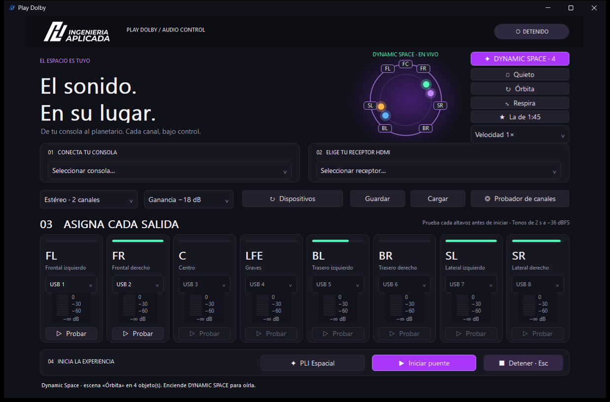
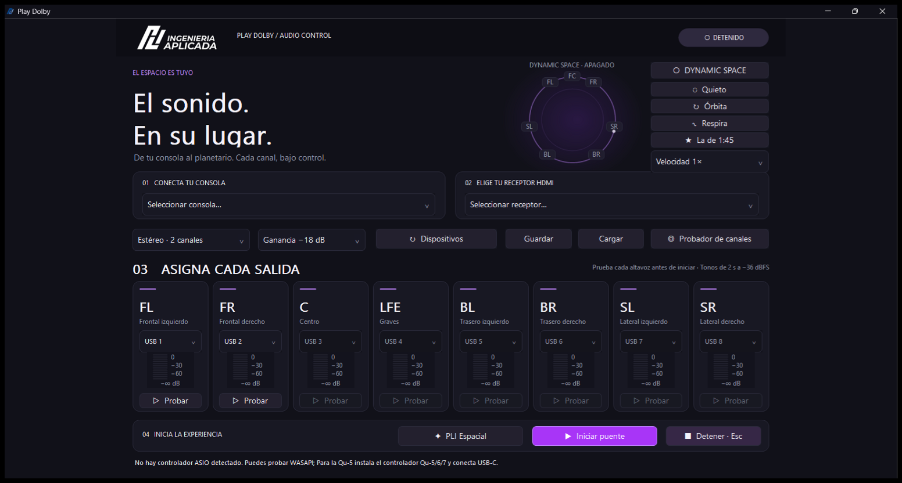
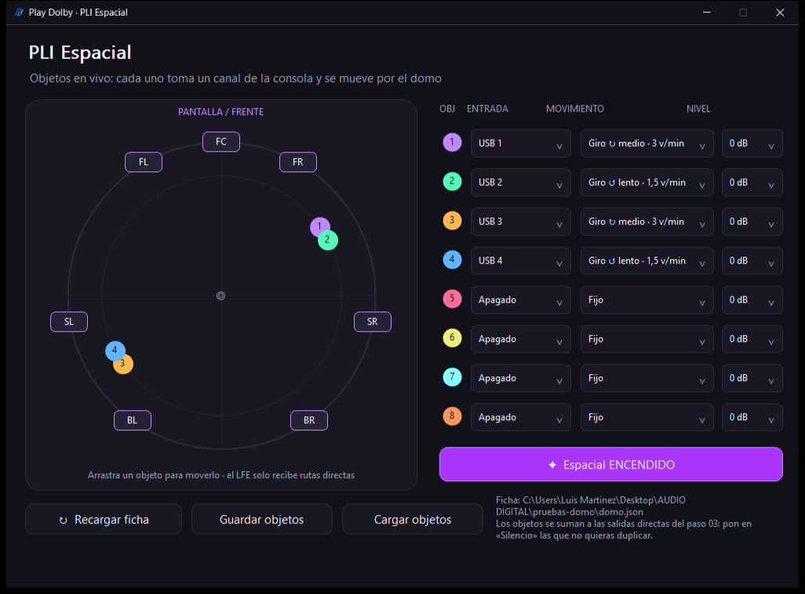

# Guía de usuario · Play Dolby

**Play Dolby** es el programa de PLI Ingeniería Aplicada que lleva el audio de la consola al domo del
planetario en **7.1**. Con **PLI Espacial**, el motor espacial propio, cada sonido se puede poner en
cualquier punto del domo y moverlo en vivo.

```
Consola Qu-5 ──USB──► PC con Play Dolby ──HDMI 7.1──► Receptor Integra ──► Amplificadores ──► Bocinas
```

> **Regla de oro:** antes de cualquier prueba, **baja el volumen del receptor**. Play Dolby arranca
> con ganancia de −18 dB a propósito.

---

## 1. Instalar

Necesitas Windows 10 u 11 de 64 bits. No hace falta ser administrador ni tener internet.

| Para… | Haz… |
|---|---|
| Instalar | Doble clic en **`INSTALAR.cmd`**, en la USB. Crea el acceso «Play Dolby» en el Escritorio y en el menú Inicio |
| Usar sin instalar | Doble clic en **`ABRIR SIN INSTALAR.cmd`**. Corre directo desde la USB |
| Desinstalar | Configuración → Aplicaciones → Aplicaciones instaladas → **Play Dolby** → Desinstalar |

Si reinstalas, se conserva tu `domo.json` (la ficha del domo, ver sección 8).

En el menú Inicio, carpeta **Play Dolby**, también encuentras:
- **Diagnóstico de audio**: qué ve Windows (receptor, 7.1, controladores).
- **Prueba de hardware**: 2 minutos de prueba de la consola al HDMI, en silencio.
- **Demo y pruebas 7.1**: música y señales de prueba.
- **Léeme** y **Desinstalar**.

## 2. Antes de la primera prueba en una PC

1. **Windows en 7.1.**
   - Abre el panel de Sonido (`mmsys.cpl`) → **Reproducción** → la salida HDMI del receptor →
     **Configurar** → **7.1 Surround**. No elijas «Dolby Atmos»: no hace falta ni se paga nada.
   - Cierra **FxSound** o **Nahimic** si están abiertos: obligan a usar estéreo.
   - Para comprobarlo, corre **Diagnóstico de audio**. Debe decir `AV Receiver … 8 canales …
     máscara 0x63F 7.1 OK`.
2. **Controlador de la Qu-5:** instala el controlador oficial de Allen & Heath (Qu-5/6/7, ASIO x64)
   desde https://www.allen-heath.com/hardware/qu/qu-5-qu-5d/resources/. El instalador de Play Dolby
   solo revisa si está.
3. **Con la consola conectada:** corre **Prueba de hardware**. Debe decir **PASA**.
4. **Cierra VLC y cualquier programa que use la salida HDMI.** Play Dolby la usa en modo exclusivo
   para tener la menor latencia, y en ese modo solo un programa a la vez puede usarla.

## 3. La pantalla principal



La ventana se puede **minimizar, maximizar y cambiar de tamaño**; el contenido se escala solo.

| Zona | Qué es |
|---|---|
| **EN VIVO / DETENIDO** (arriba a la derecha) | Dice si el audio está corriendo |
| **Domo** (arriba, centro) | El domo visto desde arriba, con las bocinas de tu ficha. Con Dynamic Space encendido, los puntos de colores son los objetos moviéndose |
| **Columna Dynamic Space** | **✦ DYNAMIC SPACE**: enciende o apaga los objetos (el número es cuántos están activos). Debajo, las **escenas rápidas** y la **velocidad maestra** (sección 6) |
| **01 Conecta tu consola** | De dónde viene el audio: la Qu-5 (ASIO), o sin consola, **▶ Archivo WAV…** o **▶ Carpeta de capas…** (sección 4) |
| **02 Elige tu receptor HDMI** | A dónde sale: la salida HDMI del receptor (WASAPI) |
| **Perfil** | Estéreo, 5.1 o **7.1 · 8 canales** |
| **Ganancia** | −18, −12, −6 o 0 dB. Empieza en −18 |
| **↻ Dispositivos** | Vuelve a buscar consola y receptor (por ejemplo, después de conectar la USB-C) |
| **Guardar / Cargar** | Guarda o carga tu configuración: dispositivos, perfil, ganancia y ruteo |
| **Probador de canales** | Ventana para mandar un tono a cada bocina, o en secuencia |
| **03 Asigna cada salida** | Una tarjeta por bocina (FL … SR): qué canal USB va a esa bocina (o «Silencio»), su medidor y **▷ Probar** (tono de 2 s a −36 dBFS). La **barra de arriba** se ilumina según cuánto le manda Dynamic Space |
| **04 Inicia la experiencia** | **✦ PLI Espacial** abre el panel de objetos. **▶ Iniciar puente** arranca el audio. **■ Detener** (o la tecla **Esc**) lo para |
| **Barra de estado** (abajo) | Mensajes y errores. Con el audio corriendo: búfer, kHz, faltas, desbordes, recortes y, si tocas un archivo, el avance «Archivo 1:23 / 2:55» |

Maximizada:



## 4. Paso a paso

### A. Probar cada bocina

1. **02**: el receptor. **Perfil**: **7.1 · 8 canales**.
2. **▷ Probar** en cada tarjeta, o **Probador de canales → Secuencia por canales**.
3. Cada tono debe salir por la bocina que dice la tarjeta. El LFE suena a 60 Hz; los demás, a 440 Hz.

### B. Reproducir un WAV 7.1 (pruebas o música)

1. **01** → **▶ Archivo WAV…** → elige un archivo de `demo\pruebas-7.1` o `demo\musica-7.1`.
2. Si el WAV es 7.1, Play Dolby pone solo el ruteo 1 a 1, el perfil 7.1 y apaga Dynamic Space,
   para que suene tal cual.
3. **02**: el receptor → **▶ Iniciar puente**. El archivo se repite al terminar.

Los mismos archivos también se pueden reproducir con **VLC**, directo a la salida HDMI.

### C. Mover los instrumentos de una canción en vivo (sin consola)

1. **01** → **▶ Carpeta de capas…** → elige `demo\capas-cosmic`.
   Play Dolby arma 6 objetos (voz, colchón, brillos, percusión, bajo y bombo) con su coreografía, pone
   el ruteo directo en «Silencio» y enciende Dynamic Space.
2. **02**: el receptor → **▶ Iniciar puente**.
3. Juega con las **escenas rápidas** y la **velocidad**, o abre **✦ PLI Espacial** y **arrastra** los
   objetos.

### D. Función con la consola Qu-5

**Con 8 fuentes estéreo** (lo más común): deja la consola configurada **una vez** con
`CONSOLA-QU5\GUIA-QU5-8-ESTEREO.md`. Ahí van los 8 pares estéreo, la salida USB por Direct Out y cómo
guardar el Show en una USB de la consola. Luego, en Play Dolby: **✦ PLI Espacial → «◆ 8 estéreo de la
consola»**, que deja los 8 objetos listos (USB 1-2 … 15-16).

Paso a paso general:

1. **01**: la Qu-5 (ASIO). La consola trabaja a **96 kHz**; Play Dolby toma esa frecuencia.
2. **02**: el receptor. **Perfil 7.1**.
3. **03**: qué canal USB va a cada bocina, o déjalo a PLI Espacial (paso 4).
4. Opcional: en **✦ PLI Espacial**, asigna canales USB a objetos. Hazlo **antes** de iniciar, para que
   el puente capture esos canales.
5. **▶ Iniciar puente.** Abajo debes ver «Faltas: 0 | desbordes: 0».

### E. Revisar la sala (kit de pruebas)

Las señales están en `demo\pruebas-7.1`; se tocan como en la receta B. Guía completa en
`LEEME-pruebas.md` y en la hoja para imprimir `hoja-de-campo.html`.

| Archivo | Qué debe pasar |
|---|---|
| `00-tonos por bocina` | Un tono por bocina, en orden |
| `01-identificacion` | Una voz dice el nombre de cada bocina y suena **solo** esa |
| `02-vuelta-al-domo` | Un ruido gira suave por el anillo. **Un salto = canales cruzados**; un hueco = nivel o polaridad |
| `03-polaridad` | En cada par de bocinas, «uno» debe sonar más lleno que «dos» |
| `05-rutina-apertura` | Revisión rápida antes de cada función |
| `04-calibracion` | **FUERTE** (−20 dBFS RMS): solo con sonómetro y el volumen controlado |

## 5. El panel PLI Espacial



Se abre con **✦ PLI Espacial**. Hay hasta **8 objetos**. Cada uno toma un canal de entrada (o un par
estéreo) y lo coloca en el domo.

| Columna | Qué elige |
|---|---|
| **Entrada** | «USB n» (mono) o «USB n-m estéreo» (L y R abiertos a los lados). «Apagado» lo quita |
| **Movimiento** | **Fijo**, **Giro** (↻ horario o ↺ antihorario: lento, medio o rápido) o **Vaivén** (se mece ±30°, ±60° o ±90°) |
| **Nivel** | 0, −3, −6, −12 o −18 dB |

- **Arrastra** un punto con el ratón para ponerlo donde quieras. También funciona mientras gira o se
  mece.
- **Espacial ENCENDIDO / apagado**: es el mismo interruptor que ✦ DYNAMIC SPACE. Se puede usar con el
  audio corriendo.
- **Recargar ficha**: vuelve a leer `domo.json`, solo con el audio detenido.
- **Guardar / Cargar objetos**: guarda la configuración de los 8 objetos.

**Importante:**
- Los objetos **se suman** a las salidas directas del paso 03. Si un canal va como objeto, pon su
  tarjeta en «Silencio» para que no suene dos veces.
- Los objetos no mandan nada al **subwoofer (LFE)**. El sub solo recibe lo que le asignes en su
  tarjeta.

## 6. Dynamic Space: escenas y velocidad

| Escena | Qué hace con los objetos activos |
|---|---|
| ◌ **Quieto** | Fijos, repartidos alrededor del domo |
| ↻ **Órbita** | Giran en sentidos alternados |
| ∿ **Respira** | Se mecen ±30° |
| ★ **La de 1:45** | La coreografía del remix que gustó: voz meciéndose al frente, colchón girando lento, brillos al revés, percusión rápida; bajo y bombo fijos al frente |

**Velocidad maestra:** multiplica todos los giros y vaivenes. **0×** los congela y **1,5×** los
acelera.

Con el audio detenido, los puntos se mueven igual (**vista previa**): sirve para ensayar sin sonido.

## 7. Errores frecuentes

| Mensaje o síntoma | Qué hacer |
|---|---|
| **No suena nada y el estado sigue en DETENIDO** | Lee la barra de abajo: el puente no arrancó y ahí dice por qué |
| «La entrada tiene N canales y … pide M» | El ruteo o un objeto pide un canal USB que la fuente no tiene. Elige la consola, otra fuente, o pon en «Silencio» lo que sobra |
| «El HDMI no acepta 8 canales… ¿Otro programa lo está usando?» | Cierra VLC u otro reproductor. Revisa que Windows esté en 7.1 (sección 2) |
| «No hay controlador ASIO detectado» | Falta el controlador de la Qu-5 (sección 2). Sin consola usa «Archivo WAV» o «Carpeta de capas» |
| Suena solo en estéreo | Windows está en 2 canales, o FxSound / Nahimic están abiertos (sección 2) |
| Suena muy bajito | Es normal a −18 dB: sube la **Ganancia** a −12 o −6 dB, poco a poco |
| «Faltas» o «desbordes» suben | Cierra programas pesados. Si sigue, avisa con el texto exacto de la barra |
| Lateral y trasero cruzados | Revisa con `02-vuelta-al-domo` y la ficha `domo.json` |

## 8. La ficha del domo (`domo.json`)

Junto a `PlayDolby.exe` está `domo.json`. Dice **a qué ángulo está cada bocina**: 0° es el frente, los
grados positivos van a la derecha y los negativos a la izquierda. Todo PLI Espacial se calcula con
esos ángulos.

```json
{"id": "SL", "voz": "Lateral izquierdo", "receptor": "Surround L", "azimut": -100, ...}
```

Hoy son ángulos **nominales**. Cuando se midan en la sala:
1. Edita `azimut` en cada bocina con el Bloc de notas.
2. En el panel PLI Espacial, con el audio detenido, pulsa **↻ Recargar ficha**.

## 9. Herramientas avanzadas (carpeta `herramientas`)

Son programas de línea de comandos; se usan desde PowerShell.

| Herramienta | Para qué | Ejemplo |
|---|---|---|
| `capas71` | Separa una canción estéreo en 6 capas, las coreografía en 7.1 y escribe `escena.json` | `capas71 cancion.wav carpeta --domo ..\domo.json` |
| `escena71` | Convierte una escena (JSON) en un WAV 7.1, en segundos | `escena71 carpeta\escena.json` |
| `adm71` | Intercambio con el estándar ADM (otros programas de audio inmersivo) | `adm71 exporta escena.json salida.wav` · `adm71 importa entrada.wav carpeta` |
| `iamf71` | IAMF (formato abierto de Google y Samsung) a 7.1, solo PCM | `iamf71 entrada.iamf salida.wav` |

El formato de las escenas está en `herramientas\ESCENAS.md`.

## 10. Actualizaciones (con aviso)

Las terminales instaladas se actualizan desde GitHub (`pliproyectos/play-dolby`) **siempre
preguntando**. El encabezado muestra la versión instalada, por ejemplo «versión 2026.10.22».

**Cuándo revisan:**
- **al prender la PC**, con un acceso en el Inicio de Windows que trabaja oculto;
- **al abrir Play Dolby y cada 12 horas** mientras está abierto;
- **cuando quieras**, con el botón **«⟳ Buscar actualizaciones»** del encabezado de Play Dolby (o
  «Buscar actualizaciones» en el menú Inicio). La barra de abajo dice el resultado: «Estás al día»,
  «No se pudo consultar GitHub (revisa internet)» o «Hay una versión nueva».

**Cuando hay una versión nueva:**
- La baja y **verifica su huella SHA-256**. Si no coincide, la descarta.
- Si Play Dolby está cerrado, pregunta «¿Instalarla ahora?».
- Si está abierto, el botón del encabezado se resalta y cambia a **«⟳ Actualización … · Instalar»**.

**Al instalar:**
- **Nunca se instala con el audio en vivo.** Primero hay que pulsar ■ Detener.
- Play Dolby se cierra, se actualiza y se vuelve a abrir.
- **Se conserva tu `domo.json`** y se guarda un respaldo de la versión anterior.
- **Si la versión nueva no arranca, regresa sola a la anterior** y lo avisa.

Sin internet no pasa nada: lo vuelve a intentar en la siguiente revisión. Lo que hace queda anotado en
`%LOCALAPPDATA%\PlanetarioBridge\actualizacion\actualizacion.log`.

**Para publicar una versión nueva (en la PC de desarrollo):**
1. Compila con los tres `native\build-*.ps1` (corren las pruebas).
2. Haz commit y push.
3. Corre `pwsh -File native\publicar-version.ps1 -Version 2026.10.25`. Arma
   `publicar\PlayDolby-2026.10.25.zip` y su `.sha256`, y abre la página de GitHub.
4. En GitHub, crea el Release con la etiqueta **`v2026.10.25`**, sube **los dos archivos** y pulsa
   **Publish release**. Esa es la señal para todas las terminales.

La versión tiene que ser **mayor** que la instalada. Para una segunda versión el mismo día:
`2026.10.25.1`.

## 11. Dónde guarda las cosas

- **Programa:** `%LOCALAPPDATA%\Programs\Play Dolby` (o la carpeta de la USB si no lo instalaste).
- **Perfil, objetos y bitácora:** `%LOCALAPPDATA%\PlanetarioBridge`
  (`perfil.txt`, `espacial.txt`, `bridge.log`). Si algo falla, `bridge.log` dice qué pasó y cuándo.
  Desinstalar **no** borra esta carpeta.
